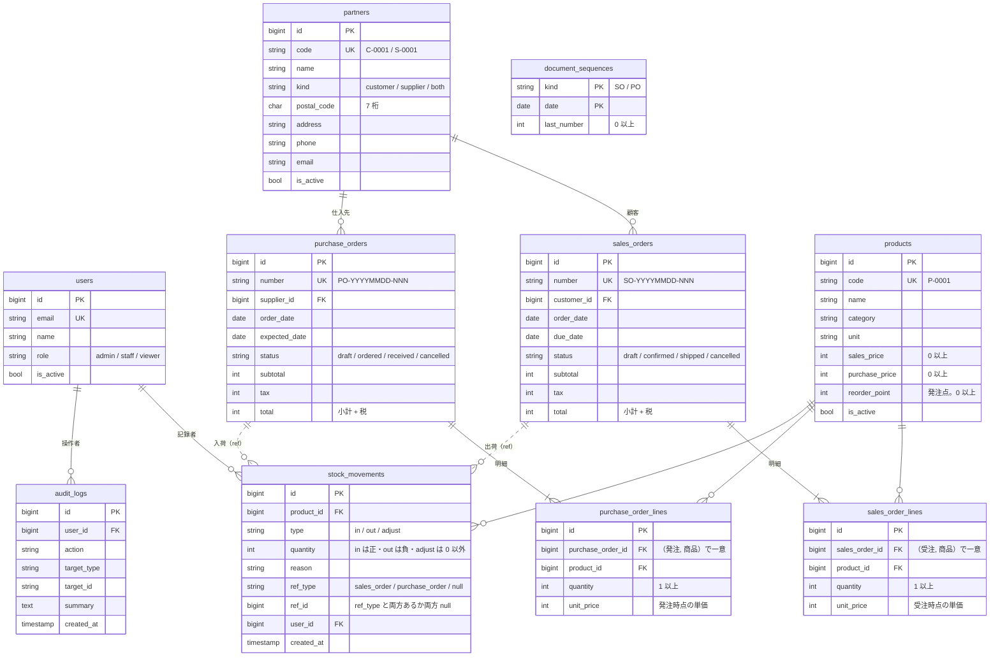

# StockFlow（Laravel）

受発注・在庫管理の社内業務システム（デモ）です。小規模な卸・小売事業者を想定し、商品・取引先・受注・発注・在庫をブラウザで管理します。

[](https://github.com/yuya1129t-project/stockflow-laravel/actions/workflows/ci.yml)

> 現在は初期構築と DB 設計の段階です（Laravel の土台・開発環境・CI、テーブル・架空のデモデータまで）。業務機能は下の「主な機能」のとおり **予定** です。

## このリポジトリについて

- 自社開発（個人の公開成果物）です
- 要件・方針の決定と公開の判断は本人が行い、設計・実装・コードレビュー（Claude と Codex の独立したレビュー）・指摘への対応は Claude Code が行っています。本人は成果物を確認しています
- **データはすべて架空です**（実在の会社・人物・取引とは関係ありません）
- [Next.js 版（stockflow-next）](https://github.com/yuya1129t-project/stockflow-next) と **同じ業務仕様**（[docs/spec.md](docs/spec.md)）・**同じ REST API 仕様**（[docs/openapi.json](docs/openapi.json)）で実装します

## 主な機能

| 機能                   | 内容                                                                   | 状態 |
| ---------------------- | ---------------------------------------------------------------------- | ---- |
| 認証・ロール権限       | admin／staff／viewer。権限はサーバー側で検査                           | 予定 |
| 商品マスタ             | 一覧・検索・登録・編集・無効化、CSV 出力・取込                         | 予定 |
| 取引先マスタ           | 一覧・検索・登録・編集・無効化、郵便番号から住所を自動入力（外部 API） | 予定 |
| 受注                   | 明細編集、税計算（1 件ごとに切り捨て）、ステータス遷移、出荷で在庫引当 | 予定 |
| 発注                   | 明細編集、税計算（1 件ごとに切り捨て）、ステータス遷移、入荷で在庫加算 | 予定 |
| 在庫                   | 現在庫一覧（発注点割れの強調）、入出庫履歴、棚卸調整                   | 予定 |
| ダッシュボード         | 今月の受注額・未出荷数・発注点割れ・入荷待ち                           | 予定 |
| ユーザー管理・操作履歴 | ユーザー・ロール管理、API トークン、操作履歴の閲覧                     | 予定 |
| 外部向け REST API      | `/api/v1`（Bearer 認証）、`docs/openapi.json` に対する契約テスト       | 予定 |
| 通知                   | 発注点割れの通知（Queue／Job）                                         | 予定 |

## 技術スタック

| 区分           | 採用技術                                                                          |
| -------------- | --------------------------------------------------------------------------------- |
| フレームワーク | Laravel 13（PHP 8.4）                                                             |
| 画面           | Laravel 公式 Vue スターターキット（Inertia 3＋Vue 3＋TypeScript＋Tailwind CSS 4） |
| 認証           | Laravel Fortify（スターターキット同梱）                                           |
| データベース   | MySQL 8.4                                                                         |
| テスト         | Pest                                                                              |
| 静的解析・整形 | Larastan（PHPStan level 7）／Pint／Vite+（フロントの lint・整形）／vue-tsc        |
| CI             | GitHub Actions（MySQL サービスに対してテスト）                                    |
| ローカル環境   | Laravel Sail（Docker Compose）                                                    |
| 実行環境       | Node.js 24／npm（Sail のコンテナ内）                                              |

## ローカル開発

必要なもの: Docker（Docker Compose が使えること）だけです。PHP・Composer・Node.js は手元に入れる必要はありません（Sail のコンテナに PHP 8.4 と Node.js 24 が入っており、その中で動かします）。

```bash
# 1. PHP の依存を入れる（Composer はコンテナで実行）
docker run --rm \
  -u "$(id -u):$(id -g)" \
  -v "$(pwd)":/var/www/html \
  -w /var/www/html \
  laravelsail/php84-composer:latest \
  composer install --ignore-platform-reqs

# 2. 環境変数のファイルを作る（.env はコミットしない）
cp .env.example .env

# 3. コンテナを起動（アプリ: http://localhost:8089 、MySQL: 127.0.0.1:33069）
./vendor/bin/sail up -d

# 4. アプリの鍵の生成、マイグレーションとデモデータの投入
./vendor/bin/sail artisan key:generate
./vendor/bin/sail artisan migrate --seed

# 5. 画面のビルド（Sail のコンテナの Node.js 24 で実行）
./vendor/bin/sail npm ci
./vendor/bin/sail npm run build
```

- ブラウザで http://localhost:8089 を開きます
- 他のプロジェクトとぶつからないよう、ホスト側のポートを `.env` の `APP_PORT`（アプリ 8089）・`FORWARD_DB_PORT`（MySQL 33069）・`VITE_PORT`（Vite の開発サーバー 5179）で変えています。アプリ・MySQL・Vite はいずれも `127.0.0.1` にだけ公開します（同じネットワークの別の端末からは届きません）
- 画面を編集しながら確認するときは `./vendor/bin/sail npm run dev` で Vite の開発サーバーを起動します（http://localhost:5179 。画面は引き続き http://localhost:8089 で開きます）
- npm の操作は Sail のコンテナの中で行います。画面のビルド時に Wayfinder（ルートの型を生成する Vite のプラグイン）が `php artisan` を呼ぶため、PHP のあるコンテナで実行する必要があります
- 止めるときは `./vendor/bin/sail down`（データベースのデータは Docker のボリュームに残ります）

## データベース

業務仕様（[docs/spec.md](docs/spec.md) §3）のテーブルと、Laravel・スターターキットのテーブル（users・sessions・cache・jobs など）があります。



- 金額・数量は整数（円・個数）、日付は `date`。現在庫は入出庫（`stock_movements.quantity`）の合計で、入出庫と操作履歴は更新・削除しません
- 値の範囲（価格 ≥ 0、数量 > 0、合計 = 小計 + 税、入出庫の符号、参照元の有無の一致、郵便番号 7 桁）とステータス等の値は **MySQL の CHECK 制約**でも守ります。ステータス等は文字列の列＋CHECK で表し、PHP 側は backed enum（`app/Enums`）に変換します
- 外部キー: 伝票 → 明細は `cascade`（伝票を消すと明細も消える）、マスタ（商品・取引先）と履歴のユーザーへの参照は `restrict`（参照があれば消せない）

### デモデータ

```bash
./vendor/bin/sail artisan migrate --seed   # テーブルを作ってデモデータを入れる
./vendor/bin/sail artisan db:seed          # デモデータだけ入れ直す（このアプリのテーブルを空にしてから投入）
```

- 商品 50・取引先 20（顧客 12・仕入先 8）・受注 80・発注 40・入出庫の履歴。すべて架空です（[Next.js 版](https://github.com/yuya1129t-project/stockflow-next) と同じ手順・同じ乱数で作るので、同じ日に作れば同じデータになります）
- 日付は投入した日から過去約 90 日に分布します。どの時点でも在庫が負にならないよう入出庫を時系列で作り、一部の商品は発注点を下回る状態にしています
- デモ用アカウント（パスワードはすべて `demo-pass-1234`。デモ専用の値です）

| ロール | メールアドレス     |
| ------ | ------------------ |
| admin  | admin@example.com  |
| staff  | staff@example.com  |
| viewer | viewer@example.com |

### データを消す操作のガード

- シード（全データを消して入れ直す）と `migrate:fresh` などの DB を消すコマンドは、DB のホストがローカル（`localhost`・`127.0.0.1`・`::1`・Sail の `mysql`）以外なら、環境変数 `STOCKFLOW_ALLOW_DESTRUCTIVE_SEED=1` がない限り実行しません（デモ環境の定期リセットでだけ設定する想定）
- テスト用 DB（`testing`）の取り違えも防ぎます: テストは `testing` でだけ動き、それ以外の環境から `testing` は消しません
- シードで消すのはこのアプリのテーブルだけです（マイグレーション履歴・キャッシュ・キューのテーブルは残します）

## テスト・静的解析

```bash
./vendor/bin/sail test                 # Pest（テスト用データベース testing に対して実行）
./vendor/bin/sail composer lint        # Pint（整形の確認のみ。直すときは composer lint:fix）
./vendor/bin/sail composer analyse     # Larastan（PHPStan）
./vendor/bin/sail npm run check        # フロントの lint・整形の確認（Vite+）
./vendor/bin/sail npm run types:check  # フロントの型チェック（vue-tsc）
./vendor/bin/sail npm run build        # 本番用ビルド
```

- テスト用のデータベース `testing` は、Sail の MySQL コンテナの初回起動時（ボリュームを作るとき）に自動で作られます。作られていない場合は `./vendor/bin/sail down -v` でボリュームを消してから起動し直します（開発用のデータも消えます）
- CI（GitHub Actions）では、MySQL 8.4 のサービスを立てて、上と同じチェックとビルドを push（main）と pull request ごとに実行します

## 開発の進め方

- タスクは GitHub Issues で管理し、1 Issue = 1 ブランチ（`feat/<issue番号>-<短い名前>`）= 1 PR で進めます
- PR は CI（Pint・Larastan・Pest・ビルド）が通り、Claude と Codex の独立したレビューの指摘に対応してからマージします
- 業務仕様は [docs/spec.md](docs/spec.md)、REST API の契約は [docs/openapi.json](docs/openapi.json)（Next.js 版と共通。変更しない）を正とします
