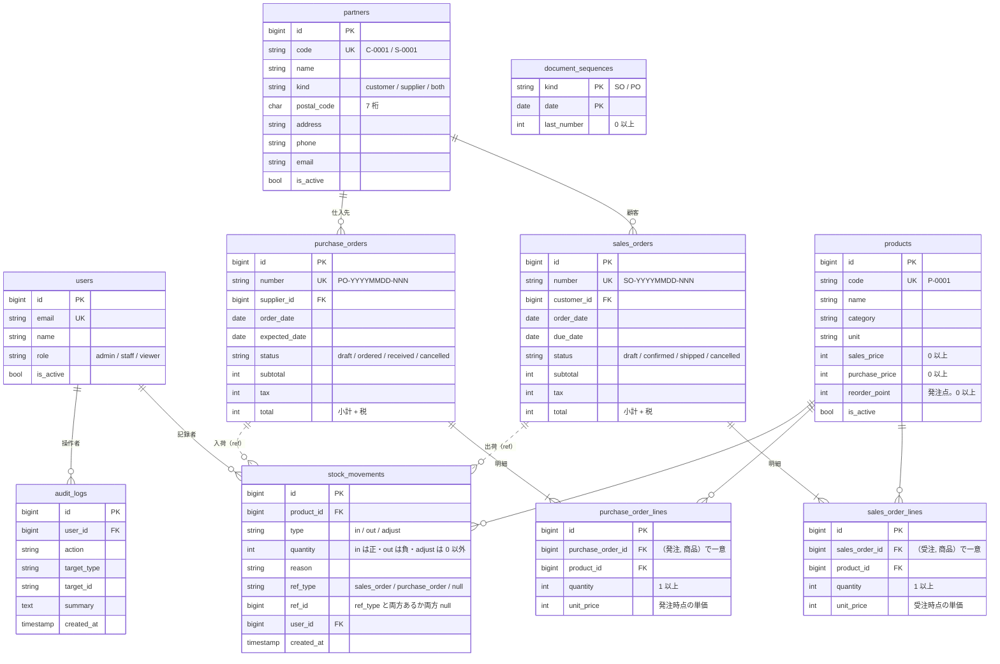

# StockFlow（Laravel）

受発注・在庫管理の社内業務システム（デモ）です。小規模な卸・小売事業者を想定し、商品・取引先・受注・発注・在庫をブラウザで管理します。

[](https://github.com/yuya1129t-project/stockflow-laravel/actions/workflows/ci.yml)

> 現在は初期構築・DB 設計・認証と、業務機能の最初の段階です（Laravel の土台・開発環境・CI、テーブル・架空のデモデータ、ログインと 3 ロールの権限、取引先マスタと郵便番号からの住所検索まで）。ほかの業務機能は下の「主な機能」のとおり **予定** です。

## このリポジトリについて

- 自社開発（個人の公開成果物）です
- 要件・方針の決定と公開の判断は本人が行い、設計・実装・コードレビュー（Claude と Codex の独立したレビュー）・指摘への対応は Claude Code が行っています。本人は成果物を確認しています
- **データはすべて架空です**（実在の会社・人物・取引とは関係ありません）
- [Next.js 版（stockflow-next）](https://github.com/yuya1129t-project/stockflow-next) と **同じ業務仕様**（[docs/spec.md](docs/spec.md)）・**同じ REST API 仕様**（[docs/openapi.json](docs/openapi.json)）で実装します

## 主な機能

| 機能                   | 内容                                                                   | 状態 |
| ---------------------- | ---------------------------------------------------------------------- | ---- |
| 認証・ロール権限       | admin／staff／viewer。権限はサーバー側で検査                           | 済み |
| 商品マスタ             | 一覧・検索・登録・編集・無効化、CSV 出力・取込                         | 予定 |
| 取引先マスタ           | 一覧・検索・登録・編集・無効化、郵便番号から住所を自動入力（外部 API） | 済み |
| 受注                   | 明細編集、税計算（1 件ごとに切り捨て）、ステータス遷移、出荷で在庫引当 | 予定 |
| 発注                   | 明細編集、税計算（1 件ごとに切り捨て）、ステータス遷移、入荷で在庫加算 | 予定 |
| 在庫                   | 現在庫一覧（発注点割れの強調）、入出庫履歴、棚卸調整                   | 予定 |
| ダッシュボード         | 今月の受注額・未出荷数・発注点割れ・入荷待ち                           | 予定 |
| ユーザー管理・操作履歴 | ユーザー・ロール管理、API トークン、操作履歴の閲覧                     | 予定 |
| 外部向け REST API      | `/api/v1`（Bearer 認証）、`docs/openapi.json` に対する契約テスト       | 予定 |
| 通知                   | 発注点割れの通知（Queue／Job）                                         | 予定 |

## 技術スタック

| 区分           | 採用技術                                                                          |
| -------------- | --------------------------------------------------------------------------------- |
| フレームワーク | Laravel 13（PHP 8.4）                                                             |
| 画面           | Laravel 公式 Vue スターターキット（Inertia 3＋Vue 3＋TypeScript＋Tailwind CSS 4） |
| 認証           | Laravel Fortify（スターターキット同梱）                                           |
| データベース   | MySQL 8.4                                                                         |
| テスト         | Pest                                                                              |
| 静的解析・整形 | Larastan（PHPStan level 7）／Pint／Vite+（フロントの lint・整形）／vue-tsc        |
| CI             | GitHub Actions（MySQL サービスに対してテスト）                                    |
| ローカル環境   | Laravel Sail（Docker Compose）                                                    |
| 実行環境       | Node.js 24／npm（Sail のコンテナ内）                                              |

## ローカル開発

必要なもの: Docker（Docker Compose が使えること）だけです。PHP・Composer・Node.js は手元に入れる必要はありません（Sail のコンテナに PHP 8.4 と Node.js 24 が入っており、その中で動かします）。

```bash
# 1. PHP の依存を入れる（Composer はコンテナで実行）
docker run --rm \
  -u "$(id -u):$(id -g)" \
  -v "$(pwd)":/var/www/html \
  -w /var/www/html \
  laravelsail/php84-composer:latest \
  composer install --ignore-platform-reqs

# 2. 環境変数のファイルを作る（.env はコミットしない）
cp .env.example .env

# 3. コンテナを起動（アプリ: http://localhost:8089 、MySQL: 127.0.0.1:33069）
./vendor/bin/sail up -d

# 4. アプリの鍵の生成、マイグレーションとデモデータの投入
./vendor/bin/sail artisan key:generate
./vendor/bin/sail artisan migrate --seed

# 5. 画面のビルド（Sail のコンテナの Node.js 24 で実行）
./vendor/bin/sail npm ci
./vendor/bin/sail npm run build
```

- ブラウザで http://localhost:8089 を開きます
- 他のプロジェクトとぶつからないよう、ホスト側のポートを `.env` の `APP_PORT`（アプリ 8089）・`FORWARD_DB_PORT`（MySQL 33069）・`VITE_PORT`（Vite の開発サーバー 5179）で変えています。アプリ・MySQL・Vite はいずれも `127.0.0.1` にだけ公開します（同じネットワークの別の端末からは届きません）
- 画面を編集しながら確認するときは `./vendor/bin/sail npm run dev` で Vite の開発サーバーを起動します（http://localhost:5179 。画面は引き続き http://localhost:8089 で開きます）
- npm の操作は Sail のコンテナの中で行います。画面のビルド時に Wayfinder（ルートの型を生成する Vite のプラグイン）が `php artisan` を呼ぶため、PHP のあるコンテナで実行する必要があります
- 止めるときは `./vendor/bin/sail down`（データベースのデータは Docker のボリュームに残ります）

## データベース

業務仕様（[docs/spec.md](docs/spec.md) §3）のテーブルと、Laravel・スターターキットのテーブル（users・sessions・cache・jobs など）があります。



- 金額・数量は整数（円・個数）、日付は `date`。現在庫は入出庫（`stock_movements.quantity`）の合計で、入出庫と操作履歴は更新・削除しません
- 値の範囲（価格 ≥ 0、数量 > 0、合計 = 小計 + 税、入出庫の符号、参照元の有無の一致、郵便番号 7 桁）とステータス等の値は **MySQL の CHECK 制約**でも守ります。ステータス等は文字列の列＋CHECK で表し、PHP 側は backed enum（`app/Enums`）に変換します
- 外部キー: 伝票 → 明細は `cascade`（伝票を消すと明細も消える）、マスタ（商品・取引先）と履歴のユーザーへの参照は `restrict`（参照があれば消せない）

### デモデータ

```bash
./vendor/bin/sail artisan migrate --seed   # テーブルを作ってデモデータを入れる
./vendor/bin/sail artisan db:seed          # デモデータだけ入れ直す（このアプリのテーブルを空にしてから投入）
```

- 商品 50・取引先 20（顧客 12・仕入先 8）・受注 80・発注 40・入出庫の履歴。すべて架空です（[Next.js 版](https://github.com/yuya1129t-project/stockflow-next) と同じ手順・同じ乱数で作るので、同じ日に作れば同じデータになります）
- 日付は投入した日から過去約 90 日に分布します。どの時点でも在庫が負にならないよう入出庫を時系列で作り、一部の商品は発注点を下回る状態にしています
- デモ用アカウント（パスワードはすべて `demo-pass-1234`。デモ専用の値です）。ログイン画面にも表示され、クリックすると入力欄に入ります（画面の表示はシードの値 `Database\Seeders\Demo\DemoData` をそのまま使うので、二重に持っていません）

| ロール | メールアドレス     |
| ------ | ------------------ |
| admin  | admin@example.com  |
| staff  | staff@example.com  |
| viewer | viewer@example.com |

### データを消す操作のガード

- シード（全データを消して入れ直す）と、`migrate:fresh`・`db:wipe` など DB を消すコマンドは、次のどれかに当たると実行しません。`--database` で別の接続を選んだときも、実行の直前にその接続を確かめます
    - ローカルの開発環境（`APP_ENV=local`）とテスト以外の環境（production・staging など）で、環境変数 `STOCKFLOW_ALLOW_DESTRUCTIVE_SEED=1` がない（DB が同じマシン上にあっても必要です。デモ環境の定期リセットでだけ設定する想定）
    - DB のホストがローカル（`localhost`・`127.0.0.1`・`::1`・Sail の `mysql`・ソケット）以外で、同じ環境変数がない
    - テスト用 DB（`testing`）の取り違え: テスト以外の環境から `testing` を消そうとしている（環境変数でも外せません）
- 本番（`APP_ENV=production`）では、`migrate:fresh` などのコマンドは環境変数があっても常に禁止です（Laravel の `DB::prohibitDestructiveCommands`）。シードだけが環境変数で許可できます
- テストは、環境が `testing` で、実際に使う DB が `testing` のときだけ動きます。設定がキャッシュされている（`config:cache` 済み）と phpunit.xml の環境変数が効かないので、テストは DB を作り直す前に中止します（`sail artisan config:clear` してから実行してください）
- シードで消すのはこのアプリのテーブルだけです（マイグレーション履歴・キャッシュ・キューのテーブルは残します）
- 日時は Asia/Tokyo の壁時計で保存します。DB の既定値（`CURRENT_TIMESTAMP`）とそろえるため、MySQL の接続のタイムゾーンを `+09:00`（`DB_TIMEZONE`）にしています

## 認証と権限

### ログイン

- Laravel Fortify のログイン・ログアウトだけを使います（`config/fortify.php` の `features` は空）。Fortify のルートは登録させず（`Fortify::ignoreRoutes()`）、ログイン・ログアウトの 3 つだけを `routes/web.php` に定義しています（機能の設定に関係なく登録されるパスワードの再確認 `/user/confirm-password` なども、ありません）。ログイン後は元の画面に戻ります（未ログインで開いた URL）
- **公開デモでデモアカウントを壊されないよう、次の機能は止めています**（ルートがなく 404 になります）。ユーザーの登録・ロール変更・無効化は admin のユーザー管理（今後の Issue）で行います
    - 公開のユーザー登録（`/register`）
    - パスワードのリセット、メールアドレスの確認（必須化もしない）
    - 名前・メールアドレスの変更、パスワードの変更、アカウントの削除（スターターキットの「設定」の画面）
    - 2 要素認証、パスキー
    - 「設定」に残しているのは外観（ライト／ダーク）だけです
- ログインの試行回数の制限: 同じメールアドレス＋IP から 1 分に 5 回、同じ IP から 1 分に 20 回まで（成功・失敗を問わず数えます）。超えると「ログインの試行回数が多すぎます。N 秒後に…」と表示します（JSON の要求には 429 と `Retry-After` ヘッダー）
    - ASCII 以外の文字を含むメールアドレスは照合せず、通常の失敗にします（DB の照合順序はゼロ幅スペースなどを無視するため、そのまま照合すると、変形したアドレスで「メールアドレス＋IP」の制限を回避できてしまう）
    - **本番での注意**: IP は `$request->ip()` で取ります。ロードバランサーの後ろに置くときは、`trustProxies` で信頼するプロキシを設定しないと全員が 1 つの IP として数えられます（1 人の試行で全員がログインできなくなる）。#14（AWS でのデモ公開）で設定し、`at: '*'` にするならアプリに直接届く経路を塞ぎます
- 無効ユーザー（`is_active = false`）: パスワードが正しくてもログインできません（パスワードが違うときは通常の失敗と同じメッセージにして、無効かどうかを明かしません）。ログイン中に無効化された場合は、次のリクエストでログアウトしてログイン画面へ移ります（`App\Http\Middleware\EnsureUserIsActive`）
- 成功したログインを操作履歴（`audit_logs`、`action = login`）に記録します（`App\Listeners\RecordLogin`。Laravel の `Login` イベント）。「ログインしたままにする」の Cookie での再認証も記録します。失敗したログインと、無効ユーザーの拒否は記録しません
- ログインに成功したとき、ハッシュの設定（コスト）が変わっていればパスワードのハッシュを作り直します（Laravel の標準のログインと同じ）

### 権限（1 か所の定義＋サーバー側の検査）

- ロールごとの権限は `App\Auth\Permission`（enum）の 1 か所だけに定義しています。業務仕様（[docs/spec.md](docs/spec.md) §2）の表と同じで、テストが spec の表を読み込んで突き合わせます（`tests/Unit/Auth/PermissionTest.php`）

| 権限（Gate のアビリティ） | 内容                                   | admin | staff | viewer |
| ------------------------- | -------------------------------------- | ----- | ----- | ------ |
| `view`                    | ダッシュボード・各一覧・詳細の閲覧     | ○     | ○     | ○      |
| `master.edit`             | 商品・取引先の登録・編集               | ○     | ○     | ×      |
| `master.deactivate`       | 商品・取引先の無効化（論理削除）       | ○     | ×     | ×      |
| `order.edit`              | 受注・発注の作成・編集・ステータス変更 | ○     | ○     | ×      |
| `stock.adjust`            | 在庫の棚卸調整                         | ○     | ○     | ×      |
| `csv.export`              | CSV 出力                               | ○     | ○     | ○      |
| `csv.import`              | CSV 取込（商品）                       | ○     | ○     | ×      |
| `user.manage`             | ユーザー管理                           | ○     | ×     | ×      |
| `audit.view`              | 操作履歴の閲覧                         | ○     | ×     | ×      |

- 各権限は Gate のアビリティとして登録しています（`AppServiceProvider`。無効ユーザーには何も許可しません）。**権限は必ずサーバー側で検査します**（画面でボタンやメニューを隠すのは補助です）
    - ルート: `Route::get(...)->can(Permission::MasterEdit)`（middleware `can:master.edit`）
    - コントローラー: `Gate::authorize(Permission::MasterEdit)`
    - Policy は「モデル単位の判定」（例: 自分自身は無効化できない）が必要な操作に使い、その中でもこの表を使います
- 権限外は HTTP 403 で、共通レイアウトの中に日本語のエラーページ（`resources/js/pages/Error.vue`）を出します。未ログインはログイン画面へ移ります。JSON の要求（`/api/*` を含む）は、未ログインが 401、権限外が 403 で、日本語のメッセージを返します
- 画面には、ログイン中のユーザーの名前・ロールと、許可された権限の一覧だけを渡します（`HandleInertiaRequests`）。サイドバーは業務仕様 §5 の画面の構成で、まだない画面は「準備中」と表示し、admin 専用の画面（ユーザー管理・操作履歴）は admin にだけ出します

## 取引先マスタと外部 API 連携

画面は「取引先」（`/partners`）。一覧・詳細はすべてのロール、登録・編集と住所検索は admin・staff、無効化・再有効化は admin だけです（ルートの `->can(...)` と `App\Policies\PartnerPolicy` で二重に検査）。

- 一覧: 取引先コード・取引先名の部分一致（大文字・小文字を区別しない。`%` `_` `\` は文字として検索）、種別の絞り込み、コード・名前・種別での並べ替え、20 件ずつのページ送り、「有効のみ（既定）／無効も表示／無効のみ」の切り替え。条件は URL のクエリに持ち、不正な値は既定値にします
    - 種別の絞り込みの「顧客」は customer と both、「仕入先」は supplier と both、「顧客・仕入先」は both だけです（spec §3 の顧客・仕入先の定義）。受注・発注で取引先を選ぶときは `Partner::query()->withRole(PartnerRole::Customer)` などで絞ります
- 入力検証（`App\Http\Requests\PartnerRequest`）: 取引先コードは半角英数字・`-`・`_`（先頭は英数字、20 文字まで）で、大文字に揃えて一意。郵便番号はハイフン有無・全角を受け付けてハイフンなしの 7 桁で保存。電話番号は 0 から始まる 10〜11 桁（全角は半角に）。メールアドレスは RFC の厳密な検査（`email:rfc,strict`。DNS は引かない）。名前・住所・メールアドレスの改行・タブ・表示方向の制御などの制御文字は拒否します（`App\Rules\SingleLine`。1 行の項目の共通の規則）。エラーは項目ごとに日本語で表示します
- 受注・発注で使われている取引先は、その役割を外す種別の変更（例 受注のある顧客を「仕入先」に）をできません。取引先の行をロックしてから伝票の件数を数えます（`App\Services\Partners\PartnerService`）
- 登録・編集・無効化・再有効化は操作履歴（`audit_logs`、`target_type = partner`）に記録します。更新と履歴は同じトランザクションで、履歴の保存に失敗したら更新も取り消します。変更のない保存は記録しません

### 郵便番号 → 住所（zipcloud）

- 外部 API（[zipcloud](https://zipcloud.ibsnet.co.jp/doc/api)）は**サーバー側**から呼びます（`App\Services\Partners\AddressLookup`。画面は `GET /partners/address-lookup?postal_code=` を呼ぶ）。タイムアウト 3 秒（接続から受信の終わりまで）、本文は 64KB まで（受信しながら数え、超えたら打ち切る。Content-Length のない応答・chunked も同じ）、リダイレクトはたどらず、応答は型・件数・長さ・制御文字・問い合わせた郵便番号との一致を検証してから使います
- 失敗・該当なしのときは「住所を手入力してください」と表示し、そのまま手入力して保存できます。失敗の原因はサーバーのログに残します。記録するのは決まった形の短い値（HTTP ステータス・cURL のエラー番号・妥当な範囲の整数の status）だけで、外部の応答の文字列・例外のメッセージ・郵便番号は出しません
- 結果は郵便番号ごとに Laravel の Cache に 1 日保存します（成功と該当なしだけ。タイムアウトなどの一時的な失敗は保存しない）。回数はユーザーごとに 1 分 30 回までで（判定と加算はキャッシュの不可分な加算で 1 手順。同時の要求でも上限を超えない）、超えると 429 と「しばらくしてから…住所を手入力してください」を返します（どちらも既定のキャッシュのストアを使います）
- 画面では、検索中に郵便番号や住所の入力が変わったら、届いた結果を捨てます（古い結果で入力を上書きしない）
- 受信の打ち切りとタイムアウトは、テスト用のローカルの HTTP サーバー（`tests/Support/raw-http-server.php`。127.0.0.1 だけ）で、実際の通信で確かめます。回数制限と種別変更の同時実行は、別プロセス・別の MySQL の接続で競合させて確かめます（`tests/Feature/Partners/ConcurrencyTest.php`）
- テストでは `Http::fake` で zipcloud を差し替えます。`tests/TestCase.php` で `Http::preventStrayRequests()` にしているので、差し替えていない外部への要求はテストの失敗になり、CI から実 API を呼びません

## テスト・静的解析

```bash
./vendor/bin/sail test                 # Pest（テスト用データベース testing に対して実行）
./vendor/bin/sail composer lint        # Pint（整形の確認のみ。直すときは composer lint:fix）
./vendor/bin/sail composer analyse     # Larastan（PHPStan）
./vendor/bin/sail npm run check        # フロントの lint・整形の確認（Vite+）
./vendor/bin/sail npm run types:check  # フロントの型チェック（vue-tsc）
./vendor/bin/sail npm run build        # 本番用ビルド
```

- テストの並列実行（`--parallel`）には対応していません（テスト用 DB の名前を `testing` に固定して判定しているため）
- テスト用のデータベース `testing` は、Sail の MySQL コンテナの初回起動時（ボリュームを作るとき）に自動で作られます。作られていない場合は `./vendor/bin/sail down -v` でボリュームを消してから起動し直します（開発用のデータも消えます）
- CI（GitHub Actions）では、MySQL 8.4 のサービスを立てて、上と同じチェックとビルドを push（main）と pull request ごとに実行します

## 開発の進め方

- タスクは GitHub Issues で管理し、1 Issue = 1 ブランチ（`feat/<issue番号>-<短い名前>`）= 1 PR で進めます
- PR は CI（Pint・Larastan・Pest・ビルド）が通り、Claude と Codex の独立したレビューの指摘に対応してからマージします
- 業務仕様は [docs/spec.md](docs/spec.md)、REST API の契約は [docs/openapi.json](docs/openapi.json)（Next.js 版と共通。変更しない）を正とします
